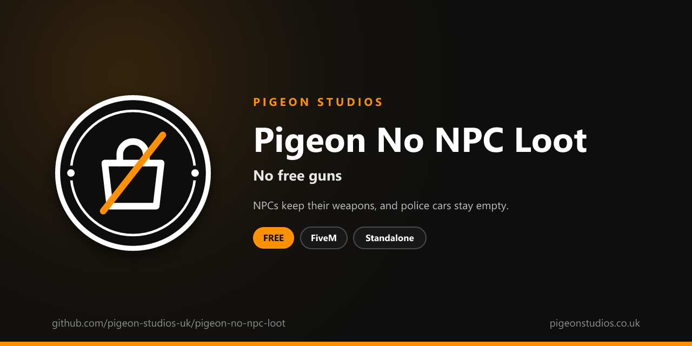

<div align="center">
  

  <h1>Pigeon No NPC Loot</h1>

  <p><strong>Stops NPCs dropping their weapons when they die, and stops police cars and other vehicles handing out free guns.</strong></p>

  <p>
    <a href="https://github.com/pigeon-studios-uk/pigeon-no-npc-loot/releases/latest"></a>
    <a href="LICENSE.md"></a>
    <a href="https://discord.gg/2NFVWEUmDF"></a>
    
  </p>

  <p>
    <a href="https://github.com/pigeon-studios-uk/pigeon-no-npc-loot/releases/latest"><strong>Download</strong></a> ·
    <a href="#installation">Install</a> ·
    <a href="#configuration">Configure</a> ·
    <a href="CHANGELOG.md">Changelog</a> ·
    <a href="https://discord.gg/2NFVWEUmDF">Support</a>
  </p>
</div>

---

## Contents

- [Overview](#overview)
- [Features](#features)
- [Requirements](#requirements)
- [Installation](#installation)
- [Updating](#updating)
- [Configuration](#configuration)
- [How it works](#how-it-works)
- [Update checker](#update-checker)
- [Performance](#performance)
- [Security](#security)
- [Troubleshooting](#troubleshooting)
- [FAQ](#faq)
- [Support](#support)
- [Contributing](#contributing)
- [Licence](#licence)
- [Credits](#credits)

## Overview

Pigeon No NPC Loot is a free resource by [Pigeon Studios](https://pigeonstudios.co.uk) that closes two ways GTA hands out free weapons. In GTA, an armed NPC drops their gun when they die, and getting into some vehicles, such as a police car, gives the player the weapon kept inside. On roleplay servers, where weapons are meant to be bought, crafted or earned, that lets anyone arm themselves by starting a fight with a security guard or jumping into a parked patrol car.

With this resource, NPCs keep their weapons when they die, and vehicles don't give players anything.

## Features

- **No drops from NPCs.** Armed NPCs, such as police, security guards and gang members, don't drop their weapon when they die.
- **No weapons from vehicles.** Getting into a police car or other vehicle doesn't give the player its shotgun or rifle.
- **Choose either.** Keep GTA's drops or vehicle weapons if you want to.
- **Players untouched.** Players' own weapons and your inventory are never affected.
- **Standalone.** No framework or other resources needed.

## Requirements

| Requirement | Version | Notes |
|---|---|---|
| FXServer | A [recommended artifact](https://runtime.fivem.net/artifacts/) | |

**Frameworks:** none needed. It works the same on standalone servers, ESX Legacy, QBCore, Qbox and ox_core.

## Installation

1. **Download** `pigeon-no-npc-loot.zip` from the [latest release](https://github.com/pigeon-studios-uk/pigeon-no-npc-loot/releases/latest). Don't use the green **Code** button; release zips are the tested builds.
2. **Extract** it into your server's `resources` folder. The folder must be called `pigeon-no-npc-loot`.
3. **Start it** by adding this to `server.cfg`:

   ```cfg
   ensure pigeon-no-npc-loot
   ```

4. **Configure** it in `configuration/config.lua` if you want to change anything. The defaults work as they are.
5. **Restart** your server. The console shows one line from the update checker:

   ```text
   [Pigeon Studios] Pigeon No NPC Loot v1.0.0 is up to date.
   ```

## Updating

1. Read the [changelog](CHANGELOG.md) for every version between yours and the latest, especially any **Upgrade notes**.
2. Back up your `configuration/` folder.
3. Replace the `pigeon-no-npc-loot` folder with the new release.
4. Copy your changed settings into the new `configuration/config.lua`. Don't copy the old file over the new one; new versions can add settings.
5. Restart the resource.

## Configuration

All settings are in `configuration/config.lua`, each explained by a comment next to it.

| Setting | Default | What it does |
|---|---|---|
| `Config.NpcWeaponDrops` | `false` | `false`: dead NPCs don't drop weapons. `true` leaves GTA's drops |
| `Config.VehicleWeapons` | `false` | `false`: vehicles don't give players weapons. `true` leaves GTA's vehicle weapons |
| `Config.NpcCheckSeconds` | `1.0` | How often new NPCs near the player are checked |

## How it works

**NPC drops.** GTA has a per-NPC setting for whether they drop their weapon when they die. Every `Config.NpcCheckSeconds`, the resource looks at the NPCs near the player and turns it off for any it hasn't seen before. Each NPC is only set once. Players are skipped. Every player runs the resource, so the NPCs around everyone are covered.

**Vehicle weapons.** GTA gives a player the weapon kept in some vehicles when they get in. Turning that off only lasts one frame, so while the player is getting into or sitting in a vehicle, the resource turns it off every frame with `DisablePlayerVehicleRewards`. On foot it only checks four times a second.

## Update checker

When it starts, Pigeon No NPC Loot checks our public [version registry](https://github.com/pigeon-studios-uk/pigeon-versions) once and prints one line in the server console saying whether it's up to date. If there's an update, it shows what's new and where to get it. The check is a single request to GitHub and sends nothing about your server or players.

Control it for every Pigeon Studios resource at once in `server.cfg`:

```cfg
set pigeon_update_check "on"      # default: one line per resource
set pigeon_update_check "quiet"   # only when there's an update or a problem
set pigeon_update_check "off"     # never check
```

## Performance

On foot it checks four times a second, and looks over the nearby NPCs once a second. In a vehicle it makes one call a frame, which costs almost nothing. Nothing runs on the server apart from the update check at start-up.

## Security

- It runs only in each player's own game, and only changes the NPCs near them and that player's own vehicle rewards.
- It has no commands, exports or network events, so there is nothing other players, other resources or the server can send it.
- The only network request is the update check at start-up, from the server to GitHub. It sends nothing about your server or players.
- Like every setting in the player's game, a player with a modified game could get around it. It changes what GTA hands out; it isn't an anti-cheat, and it doesn't stop weapons given by menus or cheats.

Found a problem? Please don't open a public issue. Use the **Report a vulnerability** button in this repository's **Security** tab, or follow our [Security Policy](https://github.com/pigeon-studios-uk/.github/blob/main/SECURITY.md).

## Troubleshooting

**An NPC still dropped a weapon.**
An NPC that appears and dies within `Config.NpcCheckSeconds` can be missed. Lower it to `0.5` if you see this often. Check the resource is started and there are no errors in the F8 console.

**Players still get a weapon in police cars.**
Check `Config.VehicleWeapons` is `false`. If another resource gives weapons when players get in, such as a police armoury, that's that resource, not GTA.

**The console says "isn't in the version registry" or "couldn't check for updates".**
Your server couldn't reach GitHub, or the check is blocked by a firewall. The resource works normally either way. Turn the check off with `set pigeon_update_check "off"`.

## FAQ

**Is it really free?**
Yes. Use it on as many servers as you like, including ones that take donations. You just can't reupload, resell or bundle it. See [Licence](#licence).

**Does it remove weapon pickups placed by other resources?**
No. Only GTA's own drops from NPCs and weapons from vehicles.

**Does it change NPCs' weapons while they're alive?**
No. Armed NPCs still carry and use their weapons.

**Does it affect players' weapons when they die?**
No. Only NPCs are changed. What happens to a player's weapons is up to your framework and inventory.

## Support

Read [Troubleshooting](#troubleshooting) first, then ask in the support channels of our [Discord](https://discord.gg/2NFVWEUmDF). Please include your Pigeon No NPC Loot version, FXServer artifact and any errors from the console. See [Getting help](https://github.com/pigeon-studios-uk/.github/blob/main/SUPPORT.md).

Found a bug? Open a [bug report](https://github.com/pigeon-studios-uk/pigeon-no-npc-loot/issues/new/choose).

## Contributing

Fixes, improvements and translations are welcome. Please read the [contributing guide](https://github.com/pigeon-studios-uk/.github/blob/main/CONTRIBUTING.md) first, and open a feature request before working on anything big.

## Licence

Pigeon No NPC Loot is free to use under the **[Pigeon Studios Free Licence](LICENSE.md)**.

- ✅ Use it on any number of servers, including monetised ones
- ✅ Change it for your own servers
- ✅ Show it in videos and streams
- ❌ Don't reupload, share or mirror the files; link to this repository instead
- ❌ Don't sell it, bundle it in packs, or put it behind escrow
- ❌ Don't remove the credits

This summary isn't the licence; [LICENSE.md](LICENSE.md) is. Third-party notices are in [NOTICE.md](NOTICE.md).

## Credits

Made by [Pigeon Studios](https://pigeonstudios.co.uk).

<sub>Not affiliated with or endorsed by Rockstar Games, Take-Two Interactive or Cfx.re.</sub>
